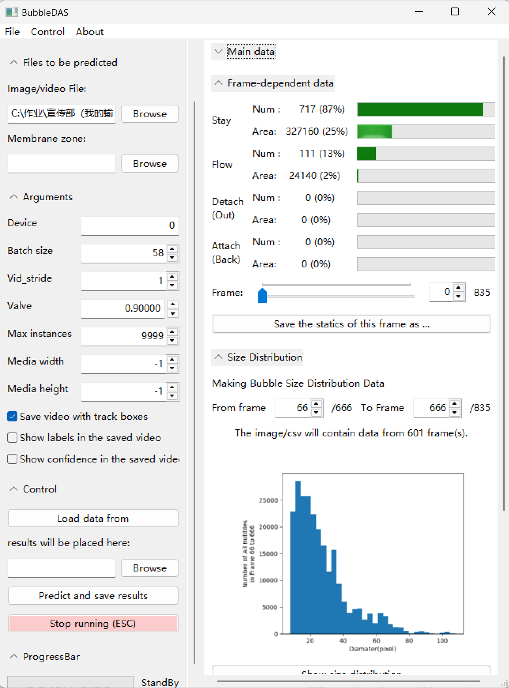

# BubbleDAS

Authors: 杨天让 (Tianrang Yang)(github account: Tim16888), 方桢 (Zhen Fang)(github account: Fang-FuDaGuoNanCeYe)

[](LICENSE)

English | [中文](README_ZH.md)

## Overview

BubbleDAS is an *integrated bubble detection tool* designed to assist research involving bubble visualization on electrodes of electrolyzers or electrolytic cells.



## Features

|                **Input Required**                |                                **Output Expected**                                 |                **Notes**                |
|:------------------------------------------------:|:----------------------------------------------------------------------------------:|:---------------------------------------:|
|                    **Video**                     | Statistics of detected bubbles (e.g., average number of staying bubbles per frame) | Output can be loaded into the software. |
|                   **Picture**                    |           `.txt` file with `xywh` coordinates (readable by **labelImg**)           |      **labelImg** may be required.      |
| **Video + Membrane area labeled by anylabeling** |               Additional statistics (e.g., membrane coverage ratio)                |    **anylabeling** may be required.     |

### Notes:

- **Bubble states** include:  
  - **Staying**: Bubbles adhering to the electrode/background.  
  - **Flowing**: Bubbles moving in the channel/foreground.  
  - **Detaching/Out**: Transition from staying to flowing.  
  - **Attaching/Back**: Transition from flowing to staying.  
  For detailed definitions, see DOI: (Manuscript under review, once published we will update this readme file)

- **labelImg** and **anylabeling** are *not required* for basic functionality, but they are recommended for input/output compatibility.

## Installation

### Quickstart (No GPU Required)

1. Download Python 3.12.13 from [python.org](https://www.python.org/).
2. Install dependencies using pip:

   ```bash
   pip install ultralytics matplotlib numpy pandas shapely tqdm wxPython pgzip
   ```

3. Clone the latest version from the `\release` folder of this repository to your computer.
4. Run `MainEntry.py`:
   - **Windows**:  
     - Open the folder containing `MainEntry.py` in File Explorer.  
     - Open the folder with `python.exe` in another window.  
     - Drag `MainEntry.py` onto `python.exe` to execute.  
   - **Alternative**:  
     ```bash
     <your python path> <the path where MainEntry.py is located>
     ```

---

### Common Installation (With GPU Support)

1. Install **a Python in 3.8–3.12** from [python.org](https://www.python.org/).
2. Install **PyTorch** compatible with your GPU:
   - Follow instructions at [https://pytorch.org/get-started/locally/](https://pytorch.org/get-started/locally/).
3. Install other dependencies:

   ```bash
   pip install ultralytics matplotlib numpy pandas shapely tqdm wxPython pgzip
   ```

4. Clone the latest version from the `\release` folder of this repository.
5. Run `MainEntry.py` using the same method as above.


---

## Tools: labelImg & anylabeling

Here is a applicable installation of labelImg and anylabeling. For official installation, visit [labelImg](https://github.com/HumanSignal/labelImg) and [anylabeling](https://github.com/vietanhdev/anylabeling).

**Attention: When replacing codes, please maintain the indentation level.**

### labelImg (for checking the output of image recognition)

1. Install via pip:

   ```bash
   pip install labelimg
   ```

2. Modify `canvas.py` (located at `<python folder>\Lib\site-packages\libs\canvas.py`):
 
   - Replace line 526:

```python
     p.drawRect(left_top.x(), left_top.y(), rect_width, rect_height)
```

with:

```python
     p.drawRect(int(left_top.x()), int(left_top.y()), int(rect_width), int(rect_height))
```

   - Replace lines 530–531:

```python
     p.drawLine(self.prev_point.x(), 0, self.prev_point.x(), self.pixmap.height())
     p.drawLine(0, self.prev_point.y(), self.pixmap.width(), self.prev_point.y())
```

with:

```python
     p.drawLine(int(self.prev_point.x()), 0, int(self.prev_point.x()), int(self.pixmap.height()))
     p.drawLine(0, int(self.prev_point.y()), int(self.pixmap.width()), int(self.prev_point.y()))
```

3. Modify `shape.py` (located at `<python folder>\Lib\site-packages\libs\shape.py`):
   - Replace line 131:

```python
painter.drawText(min_x, min_y, self.label)
```

with:

```python
painter.drawText(int(min_x), int(min_y), self.label)
```

4. Create a shortcut with the following command and run through this shortcut:

```bash
<your python folder>\pythonw.exe -c "from labelImg.labelImg import main; main()"
```

### anylabeling (for labeling membrane areas)

1. Install via pip:

   ```bash
   pip install anylabeling
   ```

2. Launch:

   ```bash
   anylabeling
   ```


## License

This project is licensed under the **AGPL 3.0** license. For details, see the [LICENSE](LICENSE) file.
